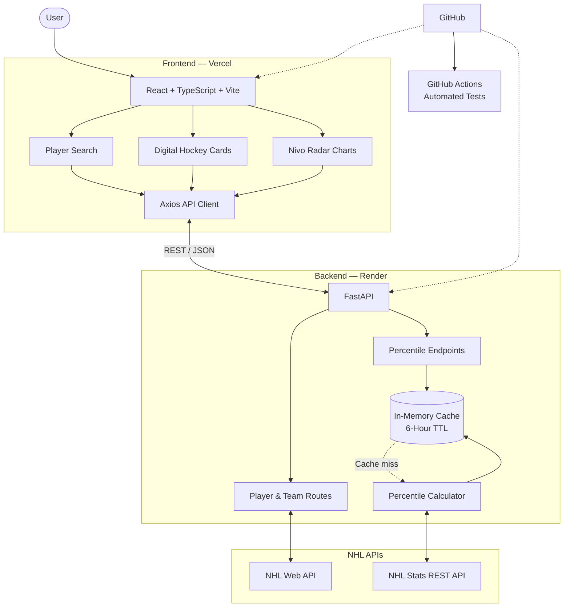

# Hockey Radar

Hockey Radar is a web app I built to make exploring NHL player stats a little more interesting. It generates digital hockey cards using data from the NHL API, combining the look of traditional hockey cards with modern data visualizations.

The project started as a simple way to look up players and their stats, and has since grown to include interactive radar charts that show how players stack up against the rest of the league.

## Live Demo

**[hockey-radar.com](https://www.hockey-radar.com)**

## Features

- **Player search:** Search for active NHL players by name and generate their hockey cards.
- **Digital hockey cards:** Flip between a player's card and their current-season statistics.
- **Performance radar charts:** Visualize a player's percentile rankings across goals, assists, points, shots, and power-play goals.
- **League-wide comparisons:** Percentiles are calculated using per-game statistics from NHL skaters who meet a minimum games-played threshold.
- **Current NHL data:** Player information and statistics come directly from the NHL API.
- **Automated testing and deployment:** CI/CD workflows help keep the app tested and up to date.

*Note: Name-based search currently supports active NHL players. Retired players can still be accessed using their NHL player ID.*

## Architecture

Hockey Radar uses a React frontend and a FastAPI backend, with the NHL API providing player information and statistics.

The backend handles player lookups and league-wide statistics. Percentile rankings are calculated using per-game rates for eligible skaters, then cached for six hours to reduce requests to the NHL API.

The frontend uses those results to generate interactive hockey cards and radar charts. There is currently no database.

## How the Percentiles Work

The radar charts compare players using per-game statistics rather than season totals, so players aren't penalized simply for having played fewer games.

When the backend needs fresh league data, it retrieves NHL skater statistics and calculates percentile rankings for each category. Those results are cached for six hours to avoid making unnecessary API requests.

Players must have appeared in at least 10 games during the current season to qualify for the comparison.

For example, a player in the 90th percentile for goals per game ranks above approximately 90% of eligible NHL skaters in that category.

## What's Next

A few things I'd like to add as the project grows:

- Side-by-side player comparisons
- More advanced statistics and visualizations
- Additional hockey card designs
- Better search support for retired players
- Continued improvements to the mobile experience

This is an ongoing personal project and a chance for me to combine two things I enjoy: hockey and building software.
